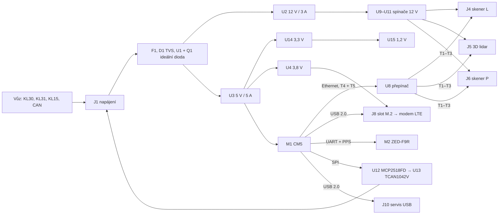

# Nosná deska ClearWay CB3 (v3)

Deska do skříně střešního skeneru v3. V konfigurátoru: v3 → Na stole, deska leží před sestavou. V záložce Díly se mezi sestavou a deskou přepíná tlačítky **Sestava / Deska**. Export → **STEP desky** dává 3D model se všemi součástkami.

> **Stav: rev. B, kompletní návrh.** Schéma, plošný spoj a výrobní data (Gerber, vrtání, kusovník, pick & place) jsou v [hardware/cb3](../../hardware/cb3/README.md). ERC i DRC jsou čisté. Návrh je generovaný a vedený autorouterem, před objednávkou ho musí projít člověk s praxí (seznam v README desky, kapitola Co zkontrolovat před výrobou).
>
> 3D model desky v aplikaci má polohy, strany a rozměry všech součástek z KiCadu (`scripts/kicad/export-3d.py`). Podklady `obrys.dxf`, `osazeni.csv` a `kusovnik.csv` níže jsou přehled z modelu pro mechaniku, pro výrobu platí jen data v `hardware/cb3/vyroba`.

Přehled vygenerovaný z modelu (`node scripts/export-board.mjs`):

| Soubor | Co obsahuje |
|---|---|
| [obrys.dxf](v3-deska/obrys.dxf) | obrys desky (vrstva OBRYS) a 4 montážní otvory (OTVORY_PTH), mm, počátek vlevo dole |
| [osazeni.csv](v3-deska/osazeni.csv) | 210 součástek: designátor, typ, souřadnice středu, strana, otočení, rozměr těla |
| [kusovnik.csv](v3-deska/kusovnik.csv) | kusovník podle typu a hodnoty |

Zdrojem pravdy je projekt KiCad. Po změně desky v KiCadu obnoví 3D model příkaz `python3 scripts/kicad/export-3d.py` (Python z KiCadu) a přehledové soubory `node scripts/export-board.mjs`. Vzhled součástek (tvar, výška, popisky) je v [src/cad/board-v3-data.js](../src/cad/board-v3-data.js).

## Co deska dělá

## Obrys a mechanika

- **Rozměr:** 242 × 162 × 1,6 mm.
- **Výřezy:** 6 půlkruhových výřezů R 7,5 mm pro sloupky víka skříně, 4 v rozích a 2 uprostřed dlouhých stran.
- **Montáž:** 4 otvory ⌀3,4 mm, prokovené a spojené se zemí (ploška ⌀6,5 mm), na sloupky ve dně skříně, šrouby M3×6. Souřadnice v modelu ±108 / ±68 mm od středu.
- **Součástky:** velké díly nahoře, 70 malých pasivních součástek (0402/0603) dole. Deska leží 8 mm nade dnem, dole nic vyššího než 1 mm.
- **Výška:** nejvyšší součástky jsou superkondenzátory a C1/C2 (~10,5 mm). Nad CM5 je měděný tepelný most do víka (je v sestavě).
- **Souřadnice v CSV a DXF:** X doprava = k přední stěně se zásuvkami M12, Y nahoru = levá strana vozu, počátek v levém dolním rohu.

## Bloky a součástky (rev. B)

Kompletní seznam se 214 součástkami je v kusovníku [hardware/cb3/vyroba/cb3-kusovnik.csv](../../hardware/cb3/vyroba/cb3-kusovnik.csv). Tady jen hlavní díly.

### Napájení (9–32 V, osobní i nákladní vůz)

| Ref | Co | Typ | Poznámka |
|---|---|---|---|
| J1 | konektor od zásuvky Deutsch DT04-6P | Molex Micro-Fit 3.0 43045-0612 | 1 KL30, 2 GND, 3 KL15, 4 CAN-H, 5 CAN-L, 6 GND |
| F1 | pojistka 5 A | Littelfuse 0466005 (1206) | ověřit jmenovité napětí ≥ 32 V |
| D1 | TVS | SMCJ33CA (1500 W, obousměrná) | přepětí a load dump |
| U1, Q1 | ideální dioda | TI LM74700-Q1 + Infineon BSC028N06LS3 (60 V) | ochrana proti přepólování a zpětnému proudu |
| C1, C2 | vstupní filtr | 2× 100 µF / 63 V hybridní polymer | |
| U2, L1, D4 | 12 V / 3 A pro senzory | TI TPS54560B | jen snižující: pod ~13 V na vstupu výstup klesá |
| U3, L2, D5 | 5 V / 5 A pro CM5 | TI TPS54560B | podle referenčního návrhu TI |
| U14 | 3,3 V / 3 A | TI TPS62130 | logika, přepínač, GNSS, CAN |
| U4 | 3,8 V / 3 A pro modem | TI TPS62130 | zapíná CM5 (MODEM_PWR_EN) |
| U15 | 1,2 V jádro přepínače | Diodes AP2112K-1.2 | |
| Q2, Q3, D2, D3 | zapínání | BSS138, BZX84C10, BAT54C | EN měničů = KL15 **nebo** PWR_HOLD z CM5 |

**Jak se zařízení zapíná a vypíná:**

1. KL30 je trvale. S vypnutými měniči deska odebírá jen klidový proud ideální diody a děličů.
2. Zapnutí zapalování (KL15) povolí měniče a CM5 nastartuje.
3. CM5 hned nastaví PWR_HOLD (GPIO27).
4. Po vypnutí KL15 (CM5 to vidí na GPIO17) CM5 dopíše data, odešle, vypne se a pustí PWR_HOLD. Měniče se vypnou.

Záloha superkondenzátory z rev. A v rev. B není. Nečekané odpojení (odpojovač baterie) systém přežije díky žurnálovacímu souborovému systému, posledních pár sekund dat se ztratí.

### Počítač

| Ref | Co | Typ |
|---|---|---|
| M1 | Raspberry Pi Compute Module 5 | CM5104032 (4 GB RAM, 32 GB eMMC, bez Wi-Fi), 2× Hirose DF40 |
| BT1 | RTC | držák CR2032 |
| U7 | teploměr desky | TI TMP1075 (I²C) |
| SW1, SW2 | nRPIBOOT, vypnutí | tlačítka |

Pouzdro CM5 je převzaté z oficiálního projektu KiCad desky CM5 IO Board.

### Ethernet a porty senzorů

| Ref | Co | Typ |
|---|---|---|
| U8, Y1 | přepínač 5 portů, krystal 25 MHz | Microchip KSZ8795CLX |
| T1–T3 | oddělovací transformátory portů | Bourns PT61017PEL |
| T4, T5 | CM5 ↔ přepínač, zády k sobě | Bourns PT61017PEL |
| U9–U11 | spínače 12 V s omezením proudu (~1,5 A) a diagnostikou | TI TPS1H100A-Q1 |
| J4–J6 | porty k panelovým M12 | JST GH 8 pinů: 1–2 +12 V, 3–4 GND, 5 TX+, 6 TX−, 7 RX+, 8 RX− |

### GNSS, LTE, CAN

| Ref | Co | Typ |
|---|---|---|
| M2 | GNSS s dead reckoningem | u-blox ZED-F9R |
| J7 | anténa GNSS | U.FL, napájení aktivní antény |
| J8 | slot M.2 Key B pro modem | TE 2199230-3, modem Quectel EM05-G |
| J9, D6 | nano-SIM + ESD | GCT SIM8060, TPD3E001 |
| U12, U13, Y2, D7 | CAN FD | MCP2518FD + TCAN1042V, krystal 40 MHz, ESD PESD2CANFD24V |

GNSS:

- **IMU je v modulu.** Deska musí být pevně přišroubovaná a v konfiguraci GNSS zadané natočení vůči vozu.
- **PPS** jde na GPIO CM5, je to přesný čas pro skenery.

CAN:

- **Rychlost vozu z CAN** výrazně zlepší polohu v úzkých ulicích. Na popelářském voze je potřeba domluvit, jaká data se smí číst.
- **Linka vozu se jen poslouchá.** Řadič je nastavený jen na příjem (listen-only), budič má STB řízený z CM5.

### Obsluha a ladění

| Ref | Co |
|---|---|
| J10, D8 | servisní USB 2.0 k panelovému USB-C (nahrání systému do eMMC přes rpiboot, konzole), ESD TPD4E05U06 |
| LED1–LED3 | zelená napájení 3,3 V, žlutá aktivita eMMC (CM5), červená stav (GPIO5) |
| J11 | ladicí UART 3,3 V |
| TP1–TP9 | testovací plošky: VIN, 12 V, 5 V, 3,3 V, 3,8 V, 1,2 V, GND, SAFEBOOT GNSS |

## Přiřazení GPIO na CM5 (rev. B)

| Funkce | GPIO / rozhraní |
|---|---|
| GNSS UART TX / RX | GPIO12 / GPIO13 (UART4) |
| GNSS PPS | GPIO18 |
| GNSS RESET_N | GPIO23 |
| CAN SPI (CS, MISO, MOSI, SCLK) + INT | SPI0: GPIO8, 9, 10, 11 + GPIO25 |
| CAN STB (budič) | GPIO6 |
| I²C (teploměr) | GPIO2 / GPIO3 |
| KL15 (zapalování, nízká úroveň = zapnuto) | GPIO17 |
| Udržení napájení PWR_HOLD | GPIO27 |
| Povolení portů 12 V (J4, J5, J6) | GPIO16, GPIO20, GPIO21 |
| Stav portů (diagnostika TPS1H100A) | GPIO19, GPIO26, GPIO24 |
| Modem: RESET, napájení | GPIO22, GPIO7 |
| Reset přepínače | GPIO4 |
| LED stav | GPIO5 |
| Ladicí UART | GPIO14 / GPIO15 (UART0) |
| Modem | USB 2.0 |
| Servisní USB | USB 2.0 OTG / boot |

## Rozpočet proudu

| Větev | Spotřebiče | Typicky | Špička | Měnič |
|---|---|---|---|---|
| 12 V | 2× skener (4 W), 3D lidar (6,5 W) | 1,2 A | 2 A při startu senzorů | TPS54560B, 3 A |
| 5 V | CM5 (do 8 W), přepínač, GNSS, CAN, 3,8 V větev | 2,2 A | 4 A | TPS54560B, 5 A |
| 3,8 V | LTE modem | 0,4 A | 2 A (vysílání) | TPS62130, 3 A |
| vstup | celkem | ~2,1 A při 12 V, ~1,1 A při 24 V | | pojistka 5 A |

## Pravidla pro návrh plošného spoje

- **4 vrstvy:** signál / GND / napájení / signál. Plná zem pod RF a pod měniči.
- **Impedance:** Ethernet a USB diferenciálně 100 Ω / 90 Ω, RF (GNSS, LTE) 50 Ω. Skladbu vrstev nechat spočítat výrobce.
- **Vzdálenosti na 60V části** (vstup až za U1): aspoň 0,5 mm mezi měděnými plochami.
- **Měniče** dál od GNSS (M2), krátké smyčky. L1 a L2 ne pod modulem GNSS.
- **Diferenciální páry Ethernetu** od transformátorů ke konektorům co nejkratší a symetrické. Pod transformátory oddělená zem (dělicí čára 1,5 mm).
- **Teplo:** pod U2, U3 a U8 tepelné prokovy do vnitřní zemní vrstvy. CM5 chladí měděný most do víka.
- **Testovací body:** VIN, 12 V, 5 V, 3,8 V, 3,3 V, GND, PPS, CAN-H, CAN-L.

## Jak z toho udělat vyrobitelnou desku

**Hotové:** [hardware/cb3](../../hardware/cb3/README.md) obsahuje schéma, plošný spoj a výrobní data.

1. **Kontrola člověkem:** projít seznam rizik v README desky (zem In1, diferenciální páry, RF GNSS, větev 12 V, pouzdro M.2).
2. **Výroba a osazení** (JLCPCB, PCBWay, nebo česká výroba, např. Gatema): nahrát `vyroba/cb3-gerber.zip`, kusovník a `cb3-osazeni.csv`. CM5, modem a GNSS osadit ručně nebo dodat výrobci.
3. **Oživení:**
   - Nejdřív bez CM5 z laboratorního zdroje s omezením proudu. Změřit napětí větví (testovací plošky TP1–TP6), klidový odběr a reakci na KL15.
   - Pak CM5, Ethernet ke každému portu, GNSS fix, LTE, CAN.
