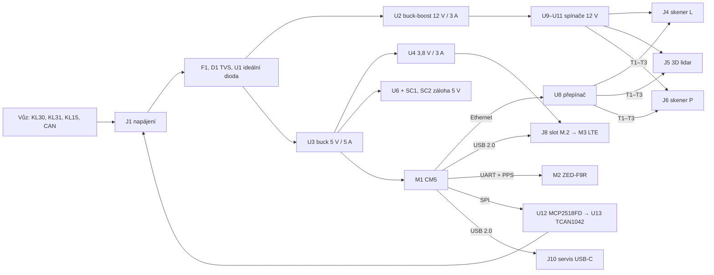

# Nosná deska ClearWay CB3 (v3)

Deska do skříně střešního skeneru v3. V konfigurátoru: v3 → Na stole, deska leží před sestavou. V záložce Díly se mezi sestavou a deskou přepíná tlačítky **Sestava / Deska**. Export → **STEP desky** dává 3D model se všemi součástkami.

> **Stav: koncept, rev. A.** Tohle je zadání a rozmístění, ne hotová výrobní data. Aby šla deska vyrobit, chybí **schéma a plošný spoj** (kapitola Jak z toho udělat vyrobitelnou desku). Typy součástek jsou návrh, každou je před objednáním nutné ověřit v datasheetu a u distributora.

Podklady vygenerované z modelu (`node scripts/export-board.mjs`):

| Soubor | Co obsahuje |
|---|---|
| [obrys.dxf](v3-deska/obrys.dxf) | obrys desky (vrstva OBRYS) a 4 montážní otvory (OTVORY_PTH), mm, počátek vlevo dole |
| [osazeni.csv](v3-deska/osazeni.csv) | 63 součástek: designátor, typ, souřadnice středu, strana, otočení, rozměr pouzdra |
| [kusovnik.csv](v3-deska/kusovnik.csv) | kusovník podle typu, pasivní součástky orientačně |

Jediný zdroj všeho je [src/cad/board-v3-data.js](../src/cad/board-v3-data.js). Když se tam změní poloha nebo typ, změní se model v aplikaci i exporty.

## Co deska dělá

## Obrys a mechanika

- **Rozměr:** 242 × 162 × 1,6 mm.
- **Výřezy:** 6 půlkruhových výřezů R 7,5 mm pro sloupky víka skříně, 4 v rozích a 2 uprostřed dlouhých stran.
- **Montáž:** 4 otvory ⌀3,4 mm, prokovené a spojené se zemí (ploška ⌀6,5 mm), na sloupky ve dně skříně, šrouby M3×6. Souřadnice v modelu ±108 / ±68 mm od středu.
- **Součástky jen nahoře** (strana TOP). Na spodní straně nic, deska leží 8 mm nade dnem.
- **Výška:** nejvyšší součástky jsou superkondenzátory a C1/C2 (~10,5 mm). Nad CM5 je měděný tepelný most do víka (je v sestavě).
- **Souřadnice v CSV a DXF:** X doprava = k přední stěně se zásuvkami M12, Y nahoru = levá strana vozu, počátek v levém dolním rohu.

## Bloky a součástky

### Napájení (9–32 V, osobní i nákladní vůz)

| Ref | Co | Návrh typu | Poznámka |
|---|---|---|---|
| J1 | konektor od zásuvky Deutsch | Molex Micro-Fit 3.0, 6 pinů | 1 KL30, 2 KL31, 3 KL15, 4 CAN-H, 5 CAN-L, 6 GND |
| F1 | pojistka 5 A | Littelfuse 2410 | pomalá |
| D1 | TVS | Vishay SM8S36A | load dump 24 V (ISO 16750-2) |
| U1, Q1, Q2 | ideální dioda + odpojení | TI LM74800-Q1 + 2× N-MOSFET 60 V | přepólování, zpětný proud, odpojení při přepětí |
| C1, C2 | 2× 100 µF / 63 V | hybridní polymer | vstupní filtr |
| U2, Q3–Q6, L1, C3 | 12 V / 3 A | TI LM5176 (buck-boost) | pro senzory, funguje i při poklesu na 9 V při startu motoru |
| U3, L2, C4 | 5 V / 5 A | TI TPS54560B | CM5 a vše za ním |
| U4, L3 | 3,8 V / 3 A | TI TPS62133 | LTE modem (špičky při vysílání ~2 A) |
| U5 | zapnutí | 74LVC1G32 + BSS138 | EN měničů = KL15 **nebo** udržení z CM5 |
| U6, SC1, SC2 | záloha | LTC3226 + 2× 10 F | při náhlé ztrátě napájení drží 5 V několik sekund na dopsání dat. **Ověřit proud zálohy.** |

**Jak se zařízení zapíná a vypíná:**

1. KL30 je trvale. Klidový odběr se vypnutými měniči má být pod 1 mA.
2. Zapnutí zapalování (KL15) povolí měniče a CM5 nastartuje.
3. CM5 hned nastaví GPIO „udržení“.
4. Po vypnutí KL15 CM5 dopíše data, odešle, vypne se a pustí udržení. Měniče se vypnou.
5. Superkondenzátory pokrývají jen nečekané odpojení (odpojovač baterie na popelářském voze, vytažený konektor).

### Počítač

| Ref | Co | Návrh typu |
|---|---|---|
| M1 | Raspberry Pi Compute Module 5 | CM5104032 (4 GB RAM, 32 GB eMMC, bez Wi-Fi) |
| J2, J3 | konektory CM5 | Hirose DF40C-100DS-0.4V(51), výška 1,5 mm |
| BT1 | RTC | držák CR2032 + dobíjecí ML2032 (CM5 má nabíjení RTC článku, **ověřit**) |
| U7 | teploměr desky | TI TMP1075 (I²C) |

Polohu konektorů J2/J3 a otvorů CM5 převzít z mechanického výkresu CM5. Model je přibližný.

### Ethernet a porty senzorů

| Ref | Co | Návrh typu |
|---|---|---|
| U8, Y1 | přepínač 5 portů, krystal 25 MHz | Microchip KSZ8795CLXIC |
| T1–T3 | oddělovací transformátory | Pulse HX1188NL |
| U9–U11 | spínače 12 V s omezením proudu a diagnostikou | TI TPS1H100-Q1 |
| D2–D4 | ESD | Semtech RClamp0524P |
| J4–J6 | porty k panelovým M12 | JST GH 8 pinů: 1–2 +12 V, 3–4 GND, 5 TX+, 6 TX−, 7 RX+, 8 RX− |

Topologie:

- **Porty 1–3 přepínače:** přes T1–T3 na J4 (skener L), J5 (3D lidar), J6 (skener P). 100 Mb/s stačí.
- **Port 4:** na Ethernet CM5. Návrh je PHY–PHY kapacitní vazbou bez transformátoru. Druhá možnost je T4. **Ověřit v aplikační poznámce Microchip.**
- **Správa přepínače po SPI** je volitelná. Ve výchozím stavu přepínač běží bez konfigurace.

### GNSS, LTE, CAN

| Ref | Co | Návrh typu |
|---|---|---|
| M2 | GNSS s dead reckoningem | u-blox ZED-F9R |
| J7, L4 | anténa GNSS | U.FL + napájení aktivní antény z VCC_RF |
| J8, M3, H1 | slot M.2 Key B + modem | TE 2199230-4, Quectel EM05-G (M.2 3042) |
| J9, D5 | nano-SIM + ESD | push-push držák, TPD3E001 |
| U12, U13, Y2, D6 | CAN FD | MCP2518FD + TCAN1042-Q1, krystal 40 MHz, ESD PESD2CANFD24V |

GNSS:

- **IMU je v modulu.** Deska musí být pevně přišroubovaná a v konfiguraci GNSS zadané natočení vůči vozu.
- **PPS** jde na GPIO CM5, je to přesný čas pro skenery.

CAN:

- **Rychlost vozu z CAN** výrazně zlepší polohu v úzkých ulicích. Na popelářském voze je potřeba domluvit, jaká data se smí číst.
- **Linka vozu se jen poslouchá.** Řadič je nastavený jen na příjem (listen-only).

### Obsluha a ladění

| Ref | Co |
|---|---|
| J10, D7 | servisní USB 2.0 k panelovému USB-C (nahrání systému do eMMC přes rpiboot, konzole) |
| SW1, SW2 | nRPIBOOT, vypnutí / reset |
| LED1–LED3 | napájení, GNSS fix, chyba |
| J11 | ladicí UART 3,3 V |

## Přiřazení GPIO na CM5 (návrh, ověřit proti datasheetu CM5)

| Funkce | GPIO / rozhraní |
|---|---|
| GNSS UART TX / RX | GPIO14 / GPIO15 (UART0) |
| GNSS PPS | GPIO18 |
| GNSS RESET_N | GPIO23 |
| CAN SPI (MOSI, MISO, SCLK, CS) + INT | SPI0: GPIO10, 9, 11, 8 + GPIO25 |
| I²C (teploměr, nabíječ, EEPROM) | GPIO2 / GPIO3 |
| KL15 (zapalování, přes dělič a omezení na 3,3 V) | GPIO17 |
| Udržení napájení | GPIO27 |
| Povolení portů 12 V (J4, J5, J6) | GPIO16, GPIO20, GPIO21 |
| Chyba portů (diagnostika TPS1H100) | GPIO19, GPIO26, GPIO12 |
| Modem: RESET, W_DISABLE, napájení | GPIO22, GPIO24, GPIO7 |
| LED 1–3 | GPIO5, GPIO6, GPIO13 |
| Ladicí UART | UART2 (GPIO0 / GPIO1 nebo podle CM5) |
| Modem | USB 2.0 (jedna USB linka CM5) |
| Servisní USB | USB 2.0 OTG / boot |

## Rozpočet proudu

| Větev | Spotřebiče | Typicky | Špička | Měnič |
|---|---|---|---|---|
| 12 V | 2× skener (4 W), 3D lidar (6,5 W) | 1,2 A | 2 A při startu senzorů | LM5176, 3 A |
| 5 V | CM5 (do 8 W), přepínač, GNSS, CAN, 3,8 V větev | 2,2 A | 4 A | TPS54560B, 5 A |
| 3,8 V | LTE modem | 0,4 A | 2 A (vysílání) | TPS62133, 3 A |
| vstup | celkem | ~2,1 A při 12 V, ~1,1 A při 24 V | | pojistka 5 A |

## Pravidla pro návrh plošného spoje

- **4 vrstvy:** signál / GND / napájení / signál. Plná zem pod RF a pod měniči.
- **Impedance:** Ethernet a USB diferenciálně 100 Ω / 90 Ω, RF (GNSS, LTE) 50 Ω. Skladbu vrstev nechat spočítat výrobce.
- **Vzdálenosti na 60V části** (vstup až za U1): aspoň 0,5 mm mezi měděnými plochami.
- **Měniče** dál od GNSS (M2), krátké smyčky. L1 a L2 ne pod modulem GNSS.
- **Diferenciální páry Ethernetu** od transformátorů ke konektorům co nejkratší a symetrické. Pod transformátory oddělená zem (dělicí čára 1,5 mm).
- **Teplo:** pod U2, U3 a U8 tepelné prokovy do vnitřní zemní vrstvy. CM5 chladí měděný most do víka.
- **Testovací body:** VIN, 12 V, 5 V, 3,8 V, 3,3 V, GND, PPS, CAN-H, CAN-L.

## Jak z toho udělat vyrobitelnou desku

**Kostra v KiCadu už je:** [hardware/cb3](../../hardware/cb3/README.md).

- **Schéma:** 5 listů se všemi součástkami. Konektory a pasivní součástky jsou zapojené.
- **Deska:** obrys, montážní otvory a pouzdra rozmístěná jako v konfigurátoru.
- **Kontrola:** ERC i DRC proběhly přes kicad-cli. Co zbývá dokreslit, je v README projektu.

1. **Doplnit schéma** v projektu: u každého IO převzít doporučené zapojení z datasheetu (hodnoty R, C, L), zástupce nahradit symboly výrobce.
2. **Plošný spoj:** obrys a rozmístění už v projektu jsou. Nástroje → Aktualizovat DPS ze schématu (F8) přenese sítě, pak tahat spoje podle pravidel výše. Polohy konektorů J1, J4–J6, J7 a J10 jsou svázané s otvory ve skříni, neměnit je.
3. **Kontroly:** DRC a ERC. 3D kontrola proti STEP sestavy z aplikace: export STEP sestavy obsahuje skříň, sloupky a tepelný most.
4. **Výroba a osazení** (JLCPCB, PCBWay, nebo česká výroba, např. Gatema): Gerber + vrtání + kusovník + pick & place. CM5, modem a GNSS osadit ručně nebo dodat výrobci.
5. **Oživení:**
   - Nejdřív bez CM5 z laboratorního zdroje s omezením proudu. Změřit napětí větví, klidový odběr a reakci na KL15.
   - Pak CM5, Ethernet ke každému portu, GNSS fix, LTE, CAN.

Dokončení schématu a plošného spoje je odhadem 3–6 týdnů práce zkušeného návrháře. Před výrobou musí návrh zkontrolovat člověk s praxí.
