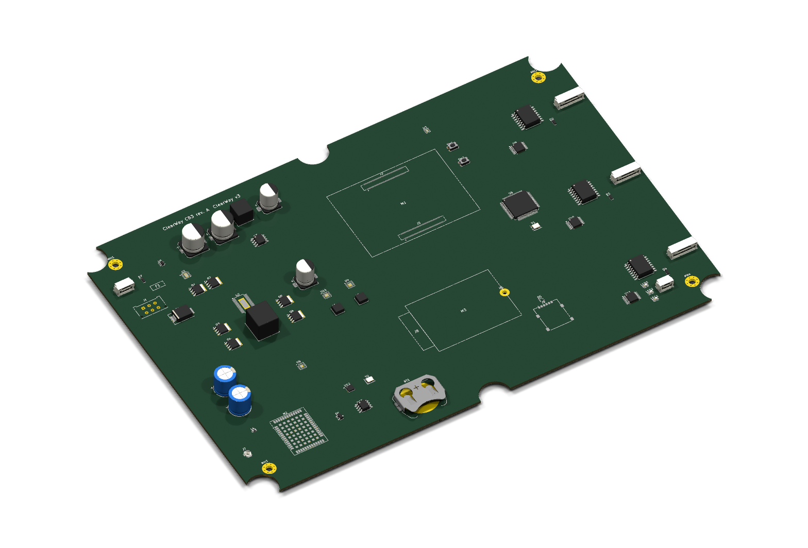

# CB3 – projekt KiCad nosné desky ClearWay v3

Kostra projektu pro KiCad 10. Vygenerovaná z tabulky součástek konfigurátoru (`configurator/src/cad/board-v3-data.js`). Popis desky, volba součástek, piny a pravidla: [configurator/docs/v3-deska.md](../../configurator/docs/v3-deska.md).



## Co v projektu je

| Soubor | Obsah |
|---|---|
| `cb3.kicad_pro` | projekt; třídy sítí Default (0,1 mm), Power (V12, V5, V3V*, GND), HV (KL30, VIN_*) |
| `cb3.kicad_sch` | přehledový list s odkazy na 5 listů bloků |
| `napajeni`, `vypocet`, `site`, `radio`, `obsluha` `.kicad_sch` | listy bloků: všech 65 součástek se symboly, pouzdry, typem (pole MPN) a poznámkou, co dokreslit |
| `cb3.kicad_pcb` | deska 242 × 162 mm, 4 vrstvy: obrys s výřezy, 4 montážní otvory, všechna pouzdra rozmístěná jako v konfigurátoru |
| `cb3.kicad_sym`, `cb3.pretty/` | zástupné symboly a pouzdra pro součástky, které ve standardních knihovnách KiCadu nejsou |
| `placement.json`, `generator-report.json` | data pro generátor a přehled, co se našlo v knihovnách |

## Stav (co je hotové a co ne)

**Hotové**
- Obrys desky, výřezy pro sloupky víka a montážní otvory (sedí na skříň v3).
- Rozmístění součástek podle konfigurátoru. DRC bez kolizí; překrývají se jen moduly, které leží nad svými konektory (CM5 nad J2/J3, modem nad J8).
- Symboly a pouzdra ze standardních knihoven: 49 symbolů, 61 pouzder.
- **Zapojené sítě:** konektory (J1, J4–J6, J10, J11) podle rozložení pinů v dokumentaci, pasivní součástky, LED, tlačítka, U.FL, budič CAN. Sítě mezi listy jsou globální popisky; netlist má 49 pojmenovaných sítí, například GND spojuje 25 vývodů.

**Chybí (práce návrháře)**
1. **Zbytek zapojení:** vývody IO podle doporučených zapojení v datasheetech (měniče, ideální dioda, přepínač Ethernet, GNSS, CM5). ERC proto hlásí ~200 nezapojených vývodů. Co kam patří, je popsané v poznámce na každém listu.
2. **Zástupci (čárkovaný obdélník):** nahradit symbolem a pouzdrem výrobce se stejným designátorem. Jde o:
   - U1 LM74800-Q1,
   - U6 LTC3226,
   - J2, J3 a M1: CM5 a jeho konektory. Nejlépe převzít z oficiálního projektu KiCad desky Raspberry Pi CM5 IO Board.
   - U8 KSZ8795,
   - T1–T3 HX1188NL,
   - U9–U11 TPS1H100-Q1,
   - D2–D4 RClamp0524P,
   - M3 modem,
   - J8 slot M.2,
   - pojistka F1.
3. **Pasivní součástky** (asi 180 kusů 0402/0603) podle schématu.
4. **Plošný spoj:** Nástroje → Aktualizovat DPS ze schématu (F8), pak tahání spojů, rozlití mědi, DRC.
5. **Výroba:** Gerber, vrtání, kusovník a pick & place pro výrobce.

## Jak to otevřít

KiCad je nainstalovaný v `~/Applications/KiCad`. Instalace přes Homebrew chtěla heslo správce, proto je ve složce uživatele. Kdo chce mít KiCad v `/Applications`, přetáhne tam celou složku `KiCad`.

1. Otevřít `cb3.kicad_pro`. Při prvním spuštění KiCad nabídne nastavení výchozích knihoven: potvrdit.
2. Editor schématu: projít listy, číst poznámky vlevo nahoře.
3. Editor DPS: rozmístění a obrys. Po doplnění schématu stisknout F8.

## Znovu vygenerovat

```bash
configurator/scripts/kicad/build.sh
```

Skript přepíše schéma i desku z tabulky `board-v3-data.js`. **Jakmile se začne v KiCadu kreslit ručně, už ho nespouštět.** Od té chvíle je zdrojem pravdy projekt KiCad a tabulka v konfigurátoru se má upravovat podle něj, ne naopak.
