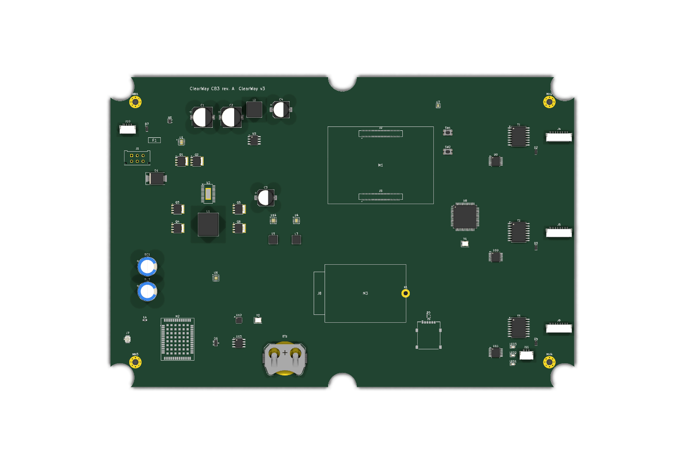

# CB3 – nosná deska ClearWay v3 (KiCad 10)

Kompletní návrh desky do skříně střešního skeneru v3: schéma, plošný spoj a výrobní data. Popis funkce, bloků a pinů: [configurator/docs/v3-deska.md](../../configurator/docs/v3-deska.md).

> **Stav: rev. B, prototyp.** Schéma i deska prošly kontrolami (ERC 0 chyb, DRC 0 nespojení a 0 kolizí). Návrh vznikl automaticky ze zapojení podle datasheetů a deska je vedená autorouterem. **Před objednávkou ho musí zkontrolovat člověk s praxí v návrhu DPS**, viz [Co zkontrolovat před výrobou](#co-zkontrolovat-před-výrobou).



## Deska

| | |
|---|---|
| Rozměr | 242 × 162 mm, 1,6 mm, obrys s výřezy pro sloupky víka a 4 otvory M3 |
| Vrstvy | 4: F.Cu signály, In1.Cu zem, In2.Cu napájení (VIN_P, 5 V) a signály, B.Cu signály a zem |
| Součástky | 214 (90 C, 51 R, 13 IO, CM5, ZED-F9R, M.2 modem …). Nahoře velké díly, **dole 70 pasivních součástek** (oboustranné osazení) |
| Spoje | 8,8 m spojů, ~500 prokovů 0,5/0,25 mm |
| Pravidla | min. spoj 0,1 mm, mezera 0,125 mm, vrták 0,2 mm (běžná 4vrstvá výroba JLCPCB/PCBWay) |
| Třídy sítí (spoj / mezera) | Default 0,13 / 0,125 mm; Diff (Ethernet, USB) 0,2 / 0,125; Power 0,4 / 0,15; Power12 0,8 / 0,2; HV (vstup) 1,0 / 0,2; Switch (uzly měničů) 0,8 / 0,2 |

Spodní strana: [cb3-bottom.png](cb3-bottom.png), pohled 3D: [cb3-iso.png](cb3-iso.png).

## Výrobní data

Složka [vyroba/](vyroba/):

| Soubor | Co to je |
|---|---|
| `cb3-gerber.zip` | Gerber všech 4 vrstev mědi, masky, pasty, potisku a obrysu + vrtání Excellon (PTH a NPTH zvlášť). Tohle se nahraje výrobci. |
| `cb3-osazeni.csv` | souřadnice pro osazovací automat (obě strany, 201 položek; montážní otvory a testovací plošky se neosazují) |
| `cb3-kusovnik.csv` | kusovník seskupený podle hodnoty, pouzdra a typu (sloupec MPN) |
| `cb3-schema.pdf` | schéma, 6 listů |
| `cb3-osazeni-top.pdf` | osazovací výkres horní strany |

Znovu vygenerovat (po změně v KiCadu):

```bash
sh configurator/scripts/kicad/fab.sh
```

**Objednávka u JLCPCB (příklad):** 4 vrstvy, 1,6 mm, standardní skladba JLC04161H-7628, HASL nebo ENIG (ENIG doporučené kvůli jemné rozteči CM5 a M.2). CM5, modul ZED-F9R a modem EM05-G je levnější dodat a osadit ručně.

## Co v projektu je

| Soubor | Obsah |
|---|---|
| `cb3.kicad_pro` | projekt a třídy sítí |
| `cb3.kicad_sch` + `napajeni`, `vypocet`, `site`, `radio`, `obsluha` | přehledový list a 5 listů bloků |
| `cb3.kicad_pcb` | deska |
| `cb3.kicad_sym`, `cb3.pretty/` | vlastní symboly (KSZ8795CLX, ZED-F9R, TPS1H100A, CM5) a pouzdra (CM5 z referenčního projektu Raspberry Pi, M.2 Key B) |
| `netlist.json` | zapojení po vývodech, ze kterého vzniká schéma i deska |

## Jak deska vznikla (skripty v `configurator/scripts/kicad/`)

1. `cb3-design.mjs`: zapojení všech součástek podle doporučených zapojení z datasheetů (zdroje v hlavičce souboru).
2. `gen-full.mjs`: schéma a `netlist.json`. ERC 0 chyb.
3. `gen-pcb-full.py place`: rozmístění (konektory u otvorů ve skříni, pasivy u svých IO, část na spodní straně), zóny a zakázané oblasti.
4. Freerouting 1.9 (export DSN / import SES), pak `finish-route.py`: vlastní dotahovač (A* na mřížce 0,1 mm) na posledních několik spojů a opravy kolizí.
5. `gen-pcb-full.py pour`: rozlití zemí a zón, `link-pcb.py`: svázání pouzder se symboly schématu (funguje F8 Aktualizovat DPS ze schématu).
6. `fab.sh`: výrobní data.
7. `export-3d.py`: polohy a rozměry součástek do 3D modelu v konfigurátoru (`src/cad/board-v3-pcb.js`).

**Od teď je zdrojem pravdy projekt KiCad.** Úpravy dělat v KiCadu ručně; generátory desku přepíší (rozmístění a vedení by se ztratilo).

## Kontroly

- **ERC:** 0 chyb, 0 varování.
- **DRC:** 0 nespojených sítí, 0 kolizí, 0 zkratů. Zbývá jen kosmetika potisku (popisky se překrývají nebo leží na ploškách, ~90 varování; výrobce potisk na ploškách ořízne).
- **Parita DPS ↔ schéma:** 17 varování, všechny jsou upevňovací a stínicí plošky konektorů (MP, SH, S1, S2), které jsou záměrně na zemi a symbol je nemá.

## Co zkontrolovat před výrobou

Seřazené podle důležitosti.

1. **Zemní vrstva In1 není souvislá.** Autorouter jí vedl asi 3,4 m signálů. Návratové cesty, rušení a GNSS tím trpí. Nejlepší oprava je převést tyto spoje na F/B/In2 a In1 nechat jako celistvou zem.
2. **Diferenciální páry** (Ethernet T1–T5, USB k modemu a servisu) jsou vedené bez řízené impedance a bez vyrovnání délek. Pro 100 Mb/s a USB 2.0 by to fungovat mělo, ale páry je potřeba projít a podle skladby výrobce nastavit šířku/mezeru na 100 Ω a 90 Ω.
3. **RF GNSS** (J7 → ZED-F9R RF_IN): spoj má mít 50 Ω (koplanár se zemí) a pod modulem souvislou zem.
4. **Větev 12 V je jen snižující** (TPS54560B). Při napětí vozu pod ~13 V (12V vůz, startování) klesne pod 12 V. Ověřit, že skenery a lidar snesou rozsah 9–12 V, jinak měnič buck-boost.
5. **Pouzdro M.2 Key B** je odvozené z pouzdra M-key z referenčního projektu CM5 (posunutý klíč). Před objednáním porovnat s výkresem TE 2199230-3.
6. **Hodnoty pasivních součástek** jsou podle referenčních návrhů TI. U U2 (12 V) je kompenzace přepočítaná, ověřit v TI WEBENCH nebo výpočtem.
7. **Teplo:** U3 (5 V / 5 A) a U2 potřebují tepelné prokovy do zemních vrstev, zkontrolovat počet pod plochou pouzdra.
8. **Ethernet CM5 ↔ přepínač** jde přes dva transformátory zády k sobě (T4, T5). Funkční, ale ověřit proti aplikační poznámce Microchip.
9. **Potisk:** přesunout překrývající se popisky (kosmetika).

## Jak to otevřít

KiCad je v `~/Applications/KiCad` (instalace přes Homebrew chtěla heslo správce). Otevřít `cb3.kicad_pro`, při prvním spuštění potvrdit výchozí knihovny.
